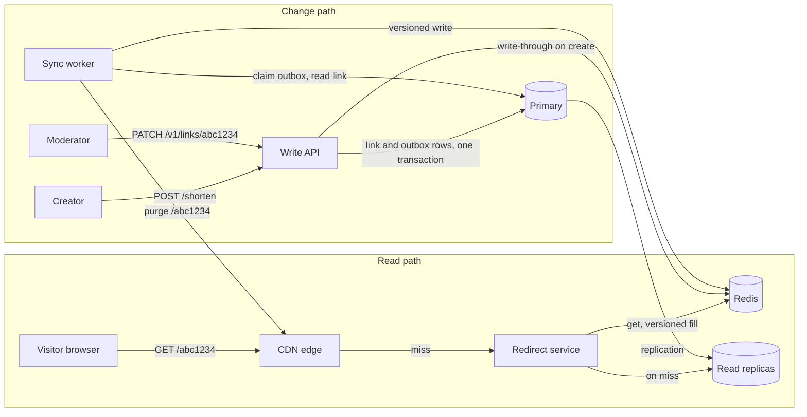
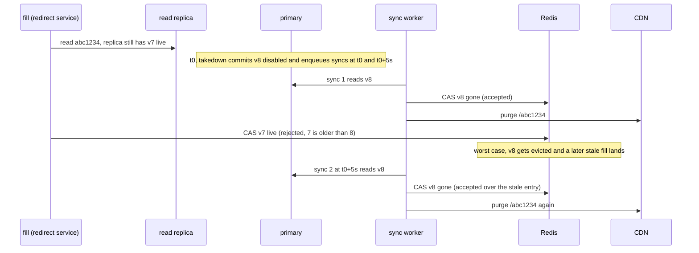

# URL shortener: cache component design

Status: draft, 2026-11-07.
Parent: [Andruil_URL_Shortener.md](Andruil_URL_Shortener.md). Whole-system diagram: [url-shortener.png](../diagrams/url-shortener/url-shortener.png).
Structure: Hello Interview's [delivery framework](https://www.hellointerview.com/learn/system-design/in-a-hurry/delivery). The time budgets in the headings are its interview pacing.

The parent caches redirects in browsers, at the CDN, and in Redis, and caches them hard because "mappings are immutable". Its own design breaks that premise twice: codes expire (`ttl`), and NFR-7 abuse handling means a link that turns malicious after creation has to come down. This component keeps every cache layer correct once a link can change state.

## 1. Requirements (~5 min)

### Functional requirements

1. Visitors should be able to follow a short link and be redirected to its destination, served by the nearest cache that holds it.
2. Moderators should be able to take a link down or restore it, and visitors should stop or resume being redirected within a bounded time. An expired link behaves like a taken-down one.
3. Creators should be able to use a link the moment they create it.

Below the line: click analytics (CDN logs cover it), multi-region caches, custom aliases, query-string pass-through.

### Non-functional requirements

1. The system should serve a cache-hit redirect at p99 under 10 ms at origin (parent NFR-1).
2. The system should propagate a takedown or restore to every cache we run within 60 s, and to browsers within 60 s + 300 s, and should never redirect a code to a URL it was not created for. Reads may be eventually consistent, but only within these bounds.
3. The system should keep serving redirects through the loss of Redis or of the store primary (parent NFR-2: 99.9% or better).
4. The system should absorb viral links and the 100:1 read skew in caches. The store primary should serve reads only in degraded mode, under a rate limit.
5. The system should withstand scanning of random codes at a cost of at most one read-replica lookup per request.

### Questions to settle with the interviewer

| Question | Assumed answer |
|---|---|
| How fast must a takedown reach people who already clicked? | 5 minutes, which sets the browser lifetime T_browser = 300 s. An answer of "at once" means T_browser = 0: no browser caching. |
| Can a taken-down link be restored? | Yes, for false positives. A restore uses the takedown path. |
| Can an expired URL be re-shortened back to its old code? | If yes, that revival is one more state change through the same path. |
| Do query strings pass through to the destination? | No. They're ignored, so they stay out of the CDN cache key. |

### Capacity estimation

Deferred, as the framework recommends. The numbers appear in the deep dives where they decide something: Redis sharding (deep dive 4), read-replica sizing (deep dive 5), and rejecting a Bloom filter (deep dive 3).

## 2. Core entities (~2 min)

- **Link**: a row in `url_mappings`, the source of truth. Short code, destination, state (live or disabled), version, expiry.
- **Cache entry**: Redis's copy of one link: version, state (live, gone, or absent), expiry, destination.
- **Redirect response**: the status and cache headers that browsers and the CDN store.
- **Change event**: a row in `cache_outbox` telling the sync worker which code to refresh, and when.

## 3. API (~5 min)

Public, the short link itself:

```
GET /{code}
  301 Location: <long_url>   live
  410                        taken down or expired (the parent returned 404)
  404                        no such code, or not 7 Base62 characters
```

Every response carries explicit cache headers (deep dive 2).

Create, the parent's API, unchanged. It gains a write-through to Redis:

```
POST /shorten  { "long_url": "https://example.com/very/long/path" }
  200 { "short_url": "https://sho.rt/abc1234", "short_code": "abc1234" }
```

Moderation, new. The moderator role comes from the auth token:

```
PATCH /v1/links/{code}  { "state": "disabled" }      (or "live" to restore)
  200 { "short_code": "abc1234", "state": "disabled", "version": 8 }
```

Internal calls:

- `cas_set(code, entry, ttl)`: a Redis script that writes only if the entry's version is newer than the cached one.
- `sync(code, kind)`: the worker step. It reads the link from the primary, applies it to Redis, and purges the CDN.
- `purge(path)`: the CDN vendor's purge API.

## 4. Data flow (optional, skipped)

The high-level design narrates both flows, a redirect and a change reaching the caches, one endpoint at a time, so a separate list would repeat it.

## 5. High-level design (~10-15 min)



Relevant columns: `url_mappings(short_code, long_url, state, version, expires_at)` and `cache_outbox(short_code, kind, due_at, done_at)`.

### GET /{code}: following a link (FR 1)

1. The browser asks the CDN. A hit returns the cached 301, 410, or 404.
2. On a miss, the CDN calls the redirect service, which asks Redis for `u:{code}`.
3. On a Redis miss, the service reads the link from a read replica, writes it into Redis, and answers.

State change: at most one Redis entry written. Noted for later: a fill that read an old row can land after a takedown (deep dive 1).

### PATCH /v1/links/{code}: takedown or restore (FR 2)

1. The write API sets `state` and bumps `version` on the primary, and in the same transaction inserts two `cache_outbox` rows: one due now and one due 5 s later.
2. The sync worker claims the due row, reads the link from the primary, and writes it into Redis, but only if its version is newer than the cached one.
3. The worker purges `/{code}` from the CDN.
4. Five seconds later, the second row repeats steps 2 and 3.

State change: one link updated, two outbox rows, one Redis entry, one CDN object purged twice. New parts: the outbox table and the sync worker. Noted for later: why twice (deep dive 1), and browsers, which can't be purged (deep dive 2).

### POST /shorten: a new link (FR 3)

1. The parent's create path commits the link at version 1, plus one `create` outbox row.
2. Before responding, it writes the entry into Redis (best effort, 5 ms timeout), so the creator's first click is a hit.
3. The worker's sync for that row repeats the write. Creates skip the CDN purge.

Noted for later: a 404 cached just before the create (deep dive 3).

### Expiry (FR 2, no endpoint)

No message is sent. Every cache lifetime is capped at `expires_at − now`, and the redirect service checks `expires_at` on every read, so an expired link turns into 410 everywhere on its own. Rows are never deleted and codes are never reused. Cost: storage only grows, and storage is the parent's stated driver (NFR-3).

### Cache lifetimes at a glance

| Layer | Holds | Lifetime | How a change reaches it |
|---|---|---|---|
| Browser | 301 only | ≤ 300 s | It can't; the lifetime bounds it |
| Shared proxies we don't run | nothing | forbidden by `private` | n/a |
| CDN | 301, 410, 404 | 301: 1 d, 410: 1 h, 404: 30 s | purge |
| Redis | one entry per code | live and gone: 24 h, absent: 30 s | versioned write |
| Read replicas | links | n/a | replication, lag ≤ 2 s enforced |

Every lifetime is capped at `expires_at − now`. Redis lifetimes get ±10% jitter, applied before the cap. Redis runs without persistence, so a restarted node starts empty, which is always safe.

## 6. Deep dives (~10 min)

### Deep dive 1: a slow fill can undo a takedown (NFR 2)

With plain cache-aside, a takedown loses this race:

1. A fill misses Redis and reads link v7 (live) from a replica.
2. The takedown commits v8 and deletes the Redis key.
3. The fill writes v7 back. The link redirects again until the entry expires, and LRU may never evict a popular one.

| Option | Advantage | Why not |
|---|---|---|
| Cache-aside: delete on change, set on fill | the standard pattern; nothing new to build | loses the race above; fails NFR 2 |
| Short lifetimes, no invalidation | nothing to build or monitor | 60 s propagation needs ~60 s lifetimes everywhere, which collapses the hit ratio the 100:1 skew relies on (NFR 4) |
| Memcache-style leases ("Scaling Memcache at Facebook", NSDI 2013) | one mechanism for stale sets and thundering herds | needs lease tokens and lease-aware clients |
| Fill from the primary, or DynamoDB `ConsistentRead` | no replica lag, so only the versioned write and one delayed sync remain | puts the primary on the read path, within scanners' reach (NFR 4 and 5); the right choice on a store that scales consistent reads cheaply |
| **Versioned writes, synced twice (chosen)** | uses the version the store already keeps; no ordering rules | two new parts to run, and correctness rests on an enforced lag bound |

**Schema.**

```sql
ALTER TABLE url_mappings
  ADD COLUMN state   text   NOT NULL DEFAULT 'live' CHECK (state IN ('live', 'disabled')),
  ADD COLUMN version bigint NOT NULL DEFAULT 1;           -- +1 on every state change
ALTER TABLE url_mappings RENAME COLUMN ttl TO expires_at; -- null = permanent

CREATE TABLE cache_outbox (
  id         bigserial   PRIMARY KEY,
  short_code text        NOT NULL,
  kind       text        NOT NULL CHECK (kind IN ('create', 'state')),
  due_at     timestamptz NOT NULL,
  done_at    timestamptz           -- kept for a day after completion, for re-syncs
);
CREATE INDEX cache_outbox_due ON cache_outbox (due_at) WHERE done_at IS NULL;
```

"Expired" is never stored. It is `expires_at < now()`, evaluated wherever an entry is read.

**Cache entry.** Key `u:{code}`, value `{version}|{state}|{expires_at_unix}|{long_url}`. State is `L` (live), `G` (gone: disabled, or already expired when filled), or `A` (absent: no link, version 0). `long_url` goes last, so a `|` inside it needs no escaping. Eviction is `allkeys-lru`; the proof below shows that losing any entry is safe.

```
u:abc1234 → 7|L|0|https://example.com/very/long/path   live, permanent
u:abc1234 → 8|G|0|                                     taken down
u:zzz9999 → 0|A|0|                                     no such code
```

**Versioned writes.** Every Redis write (fills, syncs, the create write-through) goes through this script, which runs atomically on the shard that owns the key:

```lua
-- KEYS[1] = u:{code}   ARGV[1] = version   ARGV[2] = value   ARGV[3] = ttl_ms
local cur = redis.call('GET', KEYS[1])
local cur_version = cur and tonumber(string.match(cur, '^(%d+)|'))
if cur_version and cur_version >= tonumber(ARGV[1]) then
  return 0   -- already holds this version or a newer one
end
redis.call('SET', KEYS[1], ARGV[2], 'PX', ARGV[3])
return 1
```

**The redirect service**, with the fill deadline F that the proof below relies on:

```
GET /{code}
  if code !~ ^[0-9A-Za-z]{7}$: return 404             // malformed: no lookups (deep dive 3)
  e := redis.GET("u:" + code)                         // 5 ms timeout; an error counts as a miss
  if e == nil:
      e = singleflight.Do(code, fill)                 // one fill per code per instance (deep dive 4)
  switch:
    e.state == L and not expired(e): 301, Location: e.url
    e.state == L or e.state == G:    410              // expired, or taken down
    default:                         404              // A

fill(code):
  start := monotonic_now()
  row := replica.Get(code)                            // only replicas inside the lag bound L
  e := entry(row)                                     // no link: version 0, state A
  if monotonic_now() - start < F:                     // fill deadline
      redis.EVAL(cas_set, "u:" + code, e, ttl(e))
  return e                                            // a late fill still answers; it just doesn't cache
```

**Two syncs.** A takedown, in one transaction:

```sql
UPDATE url_mappings SET state = 'disabled', version = version + 1
 WHERE short_code = $1 AND state = 'live';
INSERT INTO cache_outbox (short_code, kind, due_at) VALUES
  ($1, 'state', now()),
  ($1, 'state', now() + interval '5 seconds');   -- D
```

Sync workers claim due rows with `FOR UPDATE SKIP LOCKED` and run:

```
sync(code, kind):
  row := primary.Get(code)                       // current truth, not the event's payload
  redis.EVAL(cas_set, "u:" + code, entry(row), ttl(entry(row)))
  if kind == 'state': cdn.purge("/" + code)      // runs even if the Redis write failed
  mark done once both steps succeed; retry otherwise
```

- Because a sync reads the current link instead of carrying state, duplicates and reordering converge on the latest version.
- Delivery is at least once, and every step is idempotent.
- Creates get no delayed sync. A stale absent entry can outlive the create's entry only through eviction, and then lasts at most 30 s.

D = L + h + F + margin, where h is how often replica lag is checked. With L = 2 s, h = 1 s, F = 1 s and 1 s of margin, D = 5 s.

**Why stale state can't outlive t0 + D.** Each assumption is enforced, not hoped for: replicas over the lag bound L leave the fill pool (checked every h), fills slower than F don't write, and the versioned write is atomic. A state change commits at t0 with version n+1.

1. A replica in the fill pool lags by at most L + h, so a fill that reads at or after t0 + L + h sees n+1.
2. A fill that read earlier writes before t0 + L + h + F, or not at all.
3. So nothing carrying version n or older reaches Redis after t0 + D.
4. Sync 1 writes n+1 shortly after t0. While that entry exists, the versioned write rejects every stale fill, whichever lands first.
5. If eviction removes it and a stale fill lands, sync 2 at t0 + D overwrites the stale entry and purges the CDN again, which also drops any CDN copy refilled from it.

After t0 + D plus one purge, every layer we run serves version n+1. Cost: if the replica lag check breaks, the guarantee weakens silently; only the rejected-write metric (deep dive 5) would hint at it.

**Example: taking down abc1234.**



- New visitors get 410 within seconds of t0, and by t0 + D plus one purge at worst.
- A browser that cached the 301 before t0 keeps redirecting until its copy ages out: t0 + 300 s at most.
- No visitor is ever sent to a different destination.

### Deep dive 2: caches we can't purge (NFR 2)

Browsers can't be purged at all, and neither can shared proxies we don't run. The headers bound the first and exclude the second:

| Outcome | Status | `Cache-Control` | `CDN-Cache-Control` |
|---|---|---|---|
| live | 301, `Location` | `private, max-age=300` | `max-age=86400` |
| disabled or expired | 410 | `no-store` | `max-age=3600` |
| unknown code | 404 | `no-store` | `max-age=30` |
| malformed (not 7 Base62 chars) | 404 | `no-store` | `max-age=86400` |
| origin error | 503 | `no-store` | `no-store` |

Both max-ages on a 301 are capped at `expires_at − now`.

- `private` keeps the 301 out of shared caches we can't purge. Putting the CDN's one-day lifetime in `s-maxage` instead would bind those proxies too, so a takedown would never reach users behind them.
- `CDN-Cache-Control` is RFC 9213 (Fastly's equivalent is `Surrogate-Control`). Check that the vendor lets it override `Cache-Control`. If it doesn't, `private` stops the CDN from caching at all: the hit ratio drops, but correctness holds.
- 404 and 410 need explicit headers because RFC 9110 makes both heuristically cacheable.
- The status stays 301, as the parent chose. With explicit lifetimes, 301 versus 302 no longer decides browser caching.

Cost: a browser caches a 301 for 300 s instead of indefinitely, so a repeat click costs a CDN round trip. T_browser = 0 would make a takedown reach people who already clicked within seconds; that is the first requirements question.

### Deep dive 3: new and unknown codes (FR 3, NFR 5)

- **A create always beats a cached 404 in Redis.** An absent entry carries version 0 and a new link version 1, so the write-through and the create's sync both replace it.
- **The CDN can hold a 404 briefly.** If someone requested the code just before it existed, the CDN keeps that 404 for up to 30 s. Codes are hashes of URLs, so requesting one before it exists is rare; this is the one accepted exception to FR 3.
- **Malformed paths cost nothing.** Anything that isn't 7 Base62 characters gets a 404 with no lookups, and the CDN caches it for a day.
- **Scanners cost one replica read per request.** Random valid codes miss every layer. An edge rate limit on clients with high 404 rates caps them, and replicas absorb the rest.
- **Bloom filter rejected.** It would answer scanners without a store read, but at 10B codes and 1% false positives it needs about 12 GB, and it must be updated before each create commits. The rate limit is cheaper to try first.

### Deep dive 4: viral links and stampedes (NFR 4)

- **One origin fetch per shield.** CDN origin shield with request collapsing: purging a viral link costs one origin fetch per shield, not one per edge location.
- **One fill per code per instance.** `singleflight` in each redirect-service instance (`golang.org/x/sync/singleflight`).
- **No synchronized expiry.** ±10% lifetime jitter, so entries filled together don't expire together.
- **Redis sizing.** Memory ≈ distinct codes clicked per 24 h × (average URL + about 80 B of overhead). With a guessed 50M distinct codes a day [GUESS] at 580 B each, that's about 29 GB: three 16 GB shards, each with a replica. Replace the guess with measured numbers before buying hardware.

### Deep dive 5: failures (NFR 3)

Read replicas must carry the whole origin rate when Redis is down. With guessed inputs [GUESS] (3.2K clicks/s average, 10× peak, 85% CDN hits, 90% Redis hits), that's 32K × 0.15 = 4.8K req/s at peak, against about 480 fills/s normally.

| Failure | Effect | Response |
|---|---|---|
| Redis down | every origin request reads a replica; latency rises | replicas sized for the full origin rate; a concurrency limit sheds the rest with 503; takedowns still land through the store and CDN purges |
| Redis failover | async replication can drop the last writes, reverting recently synced codes | after a failover, re-run syncs for codes changed in the previous 10 minutes (from `cache_outbox`) |
| Replica lag over L | fills could carry stale state past t0 + D | that replica leaves the fill pool; if none qualify, fill from the primary under a rate limit |
| Sync worker stalled | changes stop propagating | alert when the oldest due outbox row is 30 s old |
| CDN purge failing | the CDN keeps serving the old response | retry with backoff and alert; worst case it expires with its CDN lifetime (1 day for a 301) |
| Primary down | no creates or takedowns; reads unaffected | fail over to the synchronous standby, losing no committed writes |
| Scanners | random valid codes miss every layer, one replica read each | edge rate limit on clients with high 404 rates (deep dive 3) |

Signals to watch:

- Hit ratio per layer, fill rate, fill latency.
- Rejected versioned writes: each one is a stale write the design stopped. Near zero normally; a rise points at replica lag or slow fills.
- Replica lag against L, the oldest due outbox row, purge errors and retries.
- Takedown end to end, from commit to the second purge's acknowledgement, against the 60 s bound.
- 404 rate per client, to spot scanners.
